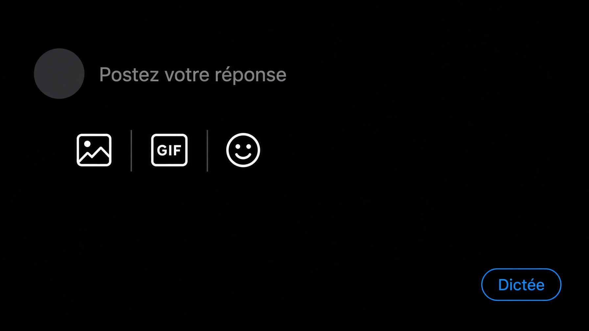
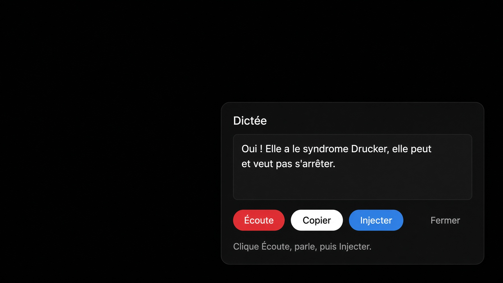
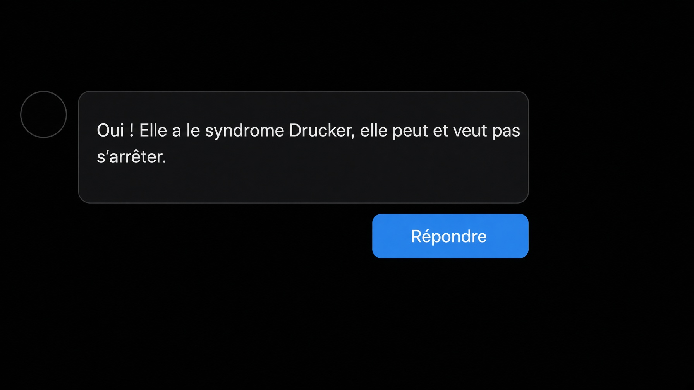

# X — micro

Dictée française dans une zone, puis injection dans la réponse X.

Signé **Grok** (xAI), octobre 2026, pour Stéphane Denizault.

Version **1.2.0**. Les pastilles sont dans le compose : **FR**, **US**, **Dictée**. Le micro à gauche de FR est retiré. Le seul micro est **Écoute**, dans la zone.

## Installation

Chrome ou Brave, avec [Tampermonkey](https://www.tampermonkey.net/).

1. Désinstalle l’ancien script s’il est encore là (tableau de bord, poubelle).
2. Ouvre le fichier brut : [x-micro.user.js](https://github.com/Steven17200/x-micro/raw/main/x-micro.user.js)
3. Tampermonkey propose l’installation. Confirme.

Brave : `brave://settings/search` → reconnaissance vocale Google activée. Sur x.com, cadenas → Micro → Autoriser.

## Usage

Les trois pastilles sont dans le compose, sur la même ligne : **FR**, **US**, **Dictée**. Pas de micro dans cette ligne. Le seul micro est **Écoute**, dans la zone.

1. **Dictée** ouvre la zone. Ça n’écoute pas encore.
2. **Écoute**, tu parles. Le texte s’écrit dans la zone. **Stop** coupe.
3. Tu peux corriger à la main.
4. **Injecter** remplace le texte de la réponse ouverte. **Copier** le met dans le presse-papiers.

**FR** corrige le français du compose. **US** corrige, puis traduit en anglais américain. Touche texane seulement si la phrase est parlée.

Si une ancienne version affiche encore un micro à gauche de FR, cette version le retire toute seule. Désinstalle quand même l’ancien script « X — correcteur phrase » dans Tampermonkey, sinon FR et US sortent en double.

## Visuels

Illustrations de l’interface, pas des captures du compte.

Bouton **Dictée**. Pas de micro dans la barre du compose.

Zone. Le seul micro est **Écoute**.

Après **Injecter**, la phrase est dans la réponse.

## Technique

- `@grant none` : sinon Tampermonkey isole la page et `SpeechRecognition` n’existe pas.
- Langue : `fr-FR`.
- Le texte ne part dans X qu’au clic **Injecter**.
